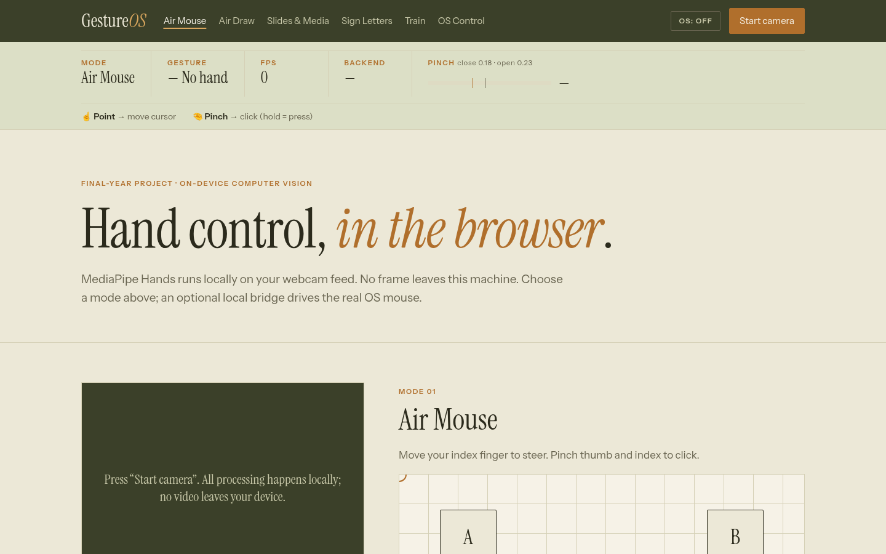
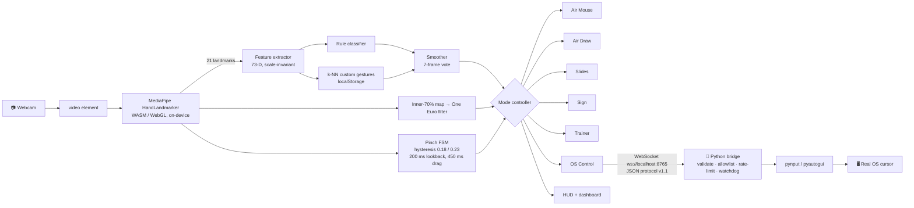

<div align="center">

# ✋ GestureOS

**Hand control from your webcam, running on-device in the browser (MediaPipe Hands), with an optional local bridge that drives the real OS mouse.**


</div>

---

## 🎬 Demo

> 📌 **TODO:** record a 15–20 s GIF (point → pinch-click a real desktop window → swipe a slide) and save it as `docs/demo.gif`.
> Add 4 stills: Air Mouse, Air Draw, Slides, Trainer (`docs/shot-*.png`).



<!--  -->

## 🚀 Quick start

**1. Web app** (all modes except OS Control):
```bash
cd gestureos
python -m http.server 8000
# open http://localhost:8000 → "Start Camera" → allow webcam
```

**2. OS bridge** (optional, controls the real mouse; use a second terminal):
```bash
python -m venv .venv && source .venv/bin/activate   # Windows: .\.venv\Scripts\Activate.ps1
pip install -r bridge/requirements.txt
python -m bridge              # real input (pynput, falls back to pyautogui)
python -m bridge --dry-run -v # log only, nothing moves
```
Then open the **OS Control** tab → **Connect** → tick **Enable OS control**.

> The camera only works on `http://localhost` or HTTPS ([secure context](https://developer.mozilla.org/en-US/docs/Web/Security/Secure_Contexts)). The first load needs internet to download MediaPipe (≈8 MB). After that the service worker caches it, so the app works offline.
> macOS: give the terminal **Accessibility** permission. Linux: requires X11 (`python-xlib`).

## ✨ Features

| Module | What it does | Key technique |
|---|---|---|
| 🖐 Hand tracking | 21 3-D landmarks × 2 hands, GPU delegate with CPU fallback | MediaPipe HandLandmarker (WASM/WebGL) |
| 🧠 Gesture engine | palm, fist, point, pinch, 👍/👎, ✌️, 🤘 | finger-state rules + 7-frame majority vote |
| 🖱 Air Mouse | in-page cursor with pinch click | **One Euro filter** + **pinch hysteresis FSM** |
| 💻 **OS Control** | real mouse: move, click, drag, scroll | WebSocket → Python bridge (pynput) |
| ✏️ Air Draw | point to draw, palm lifts the pen, fist held 1 s clears, PNG export | Canvas 2D |
| 📽 Slides / Media | swipe for next/prev, 👍 play, ✊ pause, ✌️ mute | swipe-velocity window |
| 🔤 Sign Letters | ASL subset A B D I L O V W Y + space, hold to type | geometric classifier |
| 🎓 Trainer | record custom gestures and classify them live | 73-D features + distance-weighted **k-NN**, `localStorage`, JSON import/export |
| 📊 HUD & dashboard | mode, gesture, FPS, backend, OS chip, legend, pinch meter, latency, bridge ping | `performance.now()` |
| 📦 PWA | installable, works offline | manifest + service worker (Cache API) |
| 🎨 UI | warm olive editorial theme (Instrument Serif/Sans, ochre on cream), colours as CSS tokens in `css/style.css` | plain CSS, no framework |

## 🤚 Gesture map

| Mode | Pose | Action |
|---|---|---|
| Air Mouse / OS | ☝️ Point | move cursor (inner 70% of the frame mapped to the full screen) |
| Air Mouse / OS | 🤏 Pinch < 450 ms | click at the cursor position from 200 ms **before** the pinch closed |
| OS | 🤏 Pinch held > 450 ms | drag (mouseDown → move → mouseUp) |
| OS | ✌️ Peace moved up/down | scroll |
| OS | ✊ Fist 1 s · **Esc** · hand lost | release the mouse and **pause** |
| OS | 🖐 Open palm 2 s | pause / re-enable |
| Draw | ☝️ / 🖐 / ✊ 1 s | draw / lift pen / clear |
| Slides | 🖐 swipe · 👍 · ✊ · ✌️ | next/prev · play · pause · mute |
| Sign | ASL letter held 0.8 s | type the letter |

Pinch uses **hysteresis**: ratio = ‖thumb tip − index tip‖ / ‖wrist − middle MCP‖. It **closes below 0.18** and **opens above 0.23**. The HUD meter shows both thresholds live.

## 🏗 Architecture



### Bridge safety model
- **Starts paused.** The server only accepts input after `resume`, which the app sends when you tick *Enable OS control*.
- **Pause triggers:** Esc, fist held 1 s, hand lost, the KILL button, unticking the toggle, disconnecting. Each one sends `kill`, and the server releases held buttons.
- **Watchdog:** the app pings every 500 ms. After 1.5 s of silence the bridge pauses itself (`state/watchdog`), and you have to re-enable manually.
- **Local only:** the bridge binds to 127.0.0.1, checks the Origin allowlist, applies a 120 msg/s token bucket, and accepts only allow-listed keys.
- Full protocol: [`bridge/PROTOCOL.md`](bridge/PROTOCOL.md). Bridge setup and flags: [`bridge/README.md`](bridge/README.md).

### Files
| Path | Role |
|---|---|
| `index.html`, `css/style.css` | UI, HUD, tabs |
| `js/app.js` | camera, render loop, modes, HUD, OS control logic |
| `js/gestures.js` | features, finger states, rule + ASL classifier, smoother |
| `js/filters.js` | One Euro filter, inner-frame mapping, pinch FSM |
| `js/knn.js` | k-NN with localStorage persistence |
| `js/bridge.js` | WebSocket client for the bridge (handshake, ping, throttle) |
| `sw.js`, `manifest.webmanifest` | PWA offline cache |
| `bridge/` | Python bridge server + tests |
| `docs/` | synopsis outline, viva script |

## 🆚 What's different

Most student "virtual mouse" projects (e.g. [Viral-Doshi/Gesture-Controlled-Virtual-Mouse](https://github.com/Viral-Doshi/Gesture-Controlled-Virtual-Mouse)) are Python-only OpenCV loops. GestureOS differs in these ways:
- **Inference runs in the browser, on-device.** Video is never uploaded, and the app works offline as a PWA.
- **Users can train their own gestures** with k-NN, with no retraining pipeline.
- **One engine drives many apps:** cursor, drawing, slides, sign letters, and the real OS.
- **Signal processing comes from HCI research:** the One Euro filter and a hysteresis pinch with lookback, instead of a fixed threshold.
- **The OS bridge is safe by default:** it starts paused and has a watchdog, a kill switch, and allowlists.
- **Performance is measured live:** FPS, inference latency, and bridge round-trip.

## 📈 Performance

Fill this in from the live dashboard on the demo laptop:

| Laptop / browser | FPS | `detectForVideo` (ms) | Bridge ping (ms) | Pinch-click success (20 trials) |
|---|---|---|---|---|
| _e.g. i5-1135G7 / Chrome_ | _…_ | _…_ | _…_ | _…/20_ |

## ⚠️ Limitations
- Accuracy drops in poor or back lighting. Keep the hand 40–80 cm from the camera.
- Only one hand drives the cursor and clicks. The sign letters are a static subset (no J/Z, which need motion).
- The OS bridge is opt-in and local-only. On Windows it cannot control apps running as Administrator, and macOS needs Accessibility permission.
- The custom k-NN is per-browser (localStorage). Export the JSON to move it to another browser.

## 🔮 Future scope
MediaPipe GestureRecognizer running in parallel, Model Maker custom `.task` models (HaGRID), 4-point calibration, sequence models for dynamic signs, and accessibility presets.

## 📚 Citations
1. F. Zhang, V. Bazarevsky, A. Vakunov et al., **"MediaPipe Hands: On-device Real-time Hand Tracking,"** CVPR Workshop on CV for AR/VR, 2020. [arXiv:2006.10214](https://arxiv.org/abs/2006.10214)
2. G. Sung, K. Sokal, E. Uboweja et al., **"On-device Real-time Hand Gesture Recognition,"** ICCV Workshops, 2021. [arXiv:2111.00038](https://arxiv.org/abs/2111.00038)
3. E. Uboweja, D. Tian, Q. Wang et al., **"On-device Real-time Custom Hand Gesture Recognition,"** ICCV Workshops, 2023. [arXiv:2309.10858](https://arxiv.org/abs/2309.10858) · [CVF PDF](https://openaccess.thecvf.com/content/ICCV2023W/CV4Metaverse/papers/Uboweja_On-Device_Real-Time_Custom_Hand_Gesture_Recognition_ICCVW_2023_paper.pdf)
4. G. Casiez, N. Roussel, D. Vogel, **"1€ Filter: A Simple Speed-based Low-pass Filter for Noisy Input in Interactive Systems,"** CHI 2012. DOI [10.1145/2207676.2208639](https://doi.org/10.1145/2207676.2208639) · [PDF](https://hal.science/hal-00670496/file/CHI2012-casiez.pdf) · [reference code](https://github.com/casiez/OneEuroFilter)
5. A. Kapitanov, K. Kvanchiani, A. Nagaev et al., **"HaGRID – HAnd Gesture Recognition Image Dataset,"** WACV 2024. [arXiv:2206.08219](https://arxiv.org/abs/2206.08219) · HaGRIDv2 [arXiv:2412.01508](https://arxiv.org/abs/2412.01508)
6. J. O. Wobbrock, A. D. Wilson, Y. Li, **"Gestures without Libraries, Toolkits or Training: A $1 Recognizer,"** UIST 2007. [PDF](https://faculty.washington.edu/wobbrock/pubs/uist-07.01.pdf)

**Docs and tools:** [MediaPipe Hand Landmarker (Web)](https://developers.google.com/edge/mediapipe/solutions/vision/hand_landmarker/web_js) · [Gesture Recognizer](https://developers.google.com/edge/mediapipe/solutions/vision/gesture_recognizer) · [google-ai-edge/mediapipe](https://github.com/google-ai-edge/mediapipe) · [pynput](https://pynput.readthedocs.io/en/latest/mouse.html) · [PyAutoGUI](https://pyautogui.readthedocs.io/en/latest/) · [websockets](https://websockets.readthedocs.io/en/stable/intro/tutorial1.html) · [MDN: installable PWAs](https://developer.mozilla.org/en-US/docs/Web/Progressive_web_apps/Guides/Making_PWAs_installable) · [MDN: offline operation](https://developer.mozilla.org/en-US/docs/Web/Progressive_web_apps/Guides/Offline_and_background_operation)

## 📄 License & docs
License: _to be chosen (add a `LICENSE` file)_. Bridge dependencies: [`bridge/requirements.txt`](bridge/requirements.txt).
Project report material: [`docs/synopsis-outline.md`](docs/synopsis-outline.md) · Demo script: [`docs/viva-script.md`](docs/viva-script.md)

<div align="center"><sub>B.Tech CSE final-year project · Deepanshu · 2026</sub></div>
